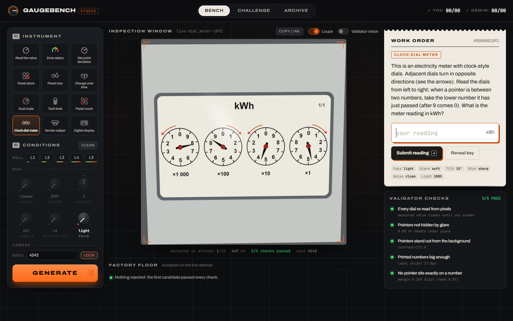
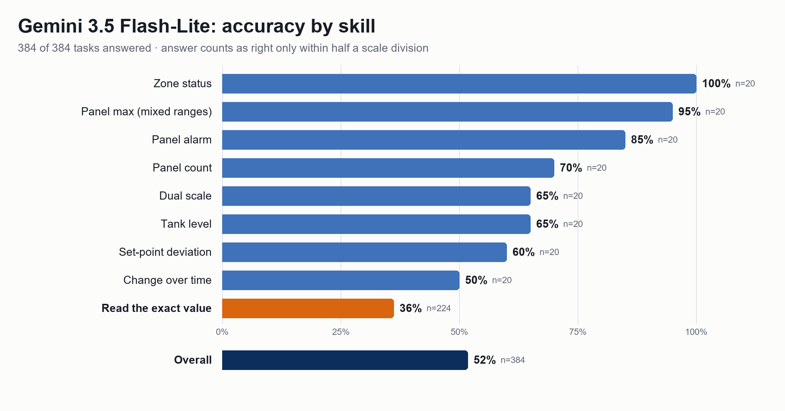
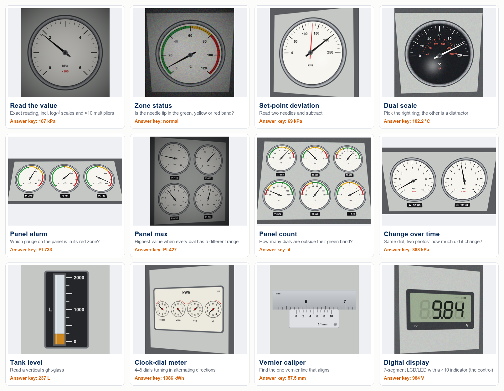
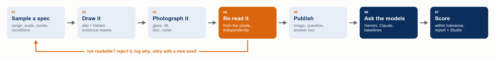
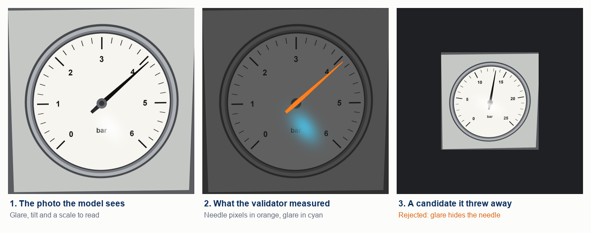
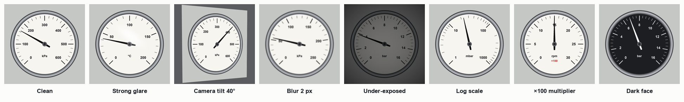
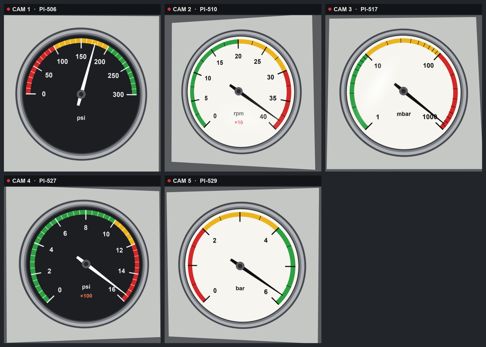
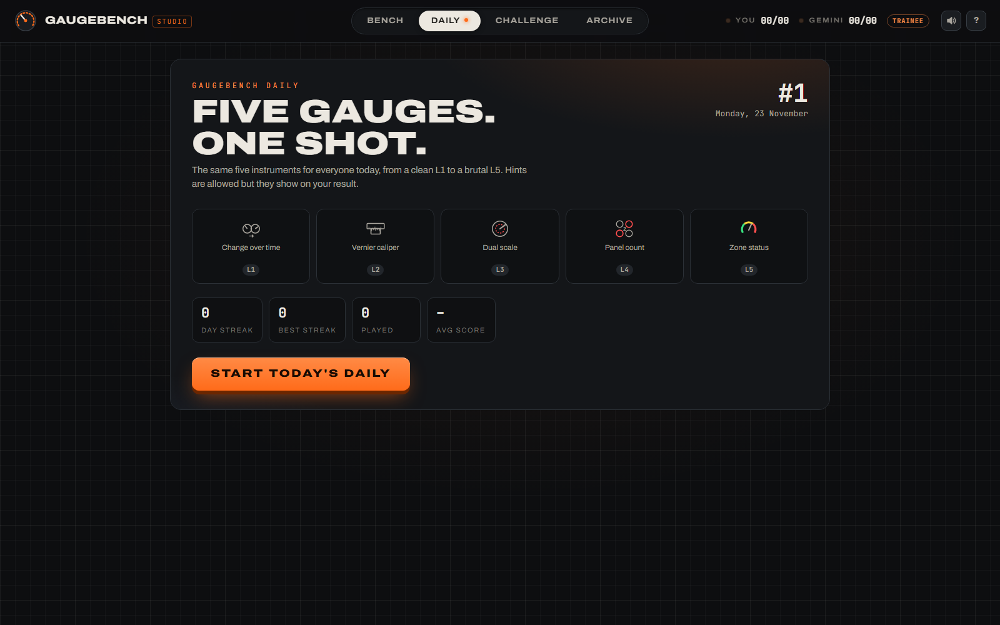
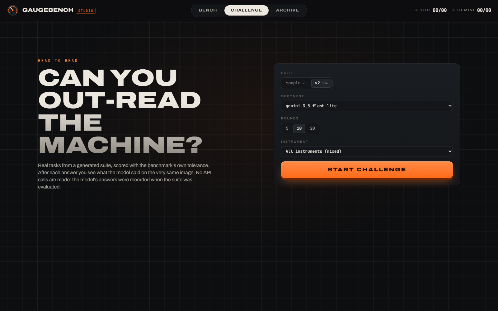
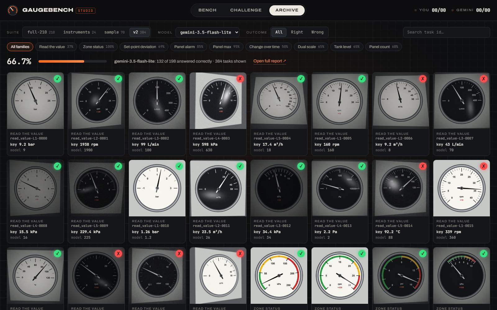

<div align="center">

# GaugeBench

**A visual task factory that tests whether AI can really read industrial gauges.**

Innodata AI Hackathon · Track 2: Visual Task Factory

[**▶ Try the live demo**](https://gaugebench-studio.onrender.com) · [How it works](#how-it-works) · [Results](#results) · [Run it yourself](#run-it-yourself)



</div>

> The live demo runs on a free server. If nobody has visited for a while, the first page load takes about a minute.

## The idea in 30 seconds

- **The problem.** Factories, refineries and utilities still run on analogue dials. Companies now point cameras at them and ask AI to log the readings and raise alarms. A misread pressure gauge can mean a missed over-pressure or a needless shutdown.
- **The question.** Can today's AI models actually *read* an instrument, or do they just get close?
- **What we built.** A factory that draws gauges, photographs them with realistic glare, tilt and blur, writes a question, and **proves the answer is readable from the pixels** before anyone is asked. It makes unlimited fresh tasks, so models can't have memorised them.
- **Questions and jobs.** Besides single questions, GaugeBench sets a whole **inspection round**: log every gauge seen by several cameras and flag the ones in the red, the way a technician's shift round works.
- **What we found.** Gemini 3.5 Flash-Lite is perfect at "roughly where is the needle?" but reads the **exact value right only about a third of the time**. In a plant, the exact value is the job.

## Results



What this shows:

- **Coarse judgements are solved.** Which colour band is the needle in? Which gauge on a panel is in alarm? The model gets these right almost every time.
- **Precise reading is not.** Asked for the actual number, it is right about 1 time in 3 (36% of 224 tasks). It snaps to the nearest labelled tick: a needle at 4.6 bar becomes "about 4". Of 175 wrong numbers, 44% were within twice the tolerance and only 1 was off by more than 20×: imprecision, not misread scales.
- **Hard conditions barely matter, fine ticks do.** Mixed tasks score 72% at level 1 and 67% at level 5. The clearest single factor is tick density: 83% with 2 small divisions between labels, 17% with 10 (the sweeps have 6 tasks per setting, so treat them as a signal, not a precise curve).
- **It reads digits, not analogue sub-divisions.** On the new instruments: digital display 62% (all 3 misses ignored the ×10/×100 indicator), clock-dial meter 12%, vernier caliper 0%. The digital display is the control, so the trouble is analogue reading itself, not the photos.
- **The whole job is out of reach.** On 20 inspection rounds it never got a round fully right: 32% of readings correct, 16 of 31 alarms caught, 4 false alarms (see [Inspection rounds](#inspection-rounds-a-job-not-a-question)).
- **The scoring is provably fair.** An answerer that knows the key scores 100%, one that is just outside tolerance scores 0%, and random guessing scores about 7%.

*All 384 tasks answered. The overall figure includes 204 single-factor sweeps of exact reading; the mixed tasks average 72%. Every answer, with the model's reasoning, is browsable in the [live Archive](https://gaugebench-studio.onrender.com/?view=archive).*

## What a task looks like

Twelve kinds of question on five kinds of instrument. Each tests a different visual skill, not just different wording.



Every task comes with:

- **the image** a model or a person sees
- **a question**, e.g. *"What is the actual measured value it shows, in kPa?"*
- **an answer key with a tolerance** of half the smallest scale division, the standard rule for reading instruments
- **every condition used to make it** and **the full validation evidence**, so any task can be audited or regenerated from its seed

<details>
<summary><b>All 12 task families, explained</b></summary>

| Family | What the model must do | Answer |
|---|---|---|
| Read the value | precise reading, including non-linear (√, log) scales, negative ranges and printed multipliers (×10, ×0.1) | number ± tolerance |
| Zone status | relate the needle to coloured safety bands (high- *and* low-alarm layouts) | normal / warning / danger |
| Set-point deviation | read two needles (actual and red set point) and subtract | signed number |
| Panel alarm | scan a 3–6 gauge panel and find the one in its red zone | instrument tag |
| Panel max | compare dials with **different ranges**: the furthest-turned needle is often *not* the highest value | instrument tag |
| Change over time | read the same dial in two photos and compute the change | signed number |
| Dual scale | pick the right ring on a two-scale dial (bar/psi, °C/°F); the other ring is a distractor | number ± tolerance |
| Tank level | read a vertical sight-glass: a different geometry with a liquid surface | number ± tolerance |
| Panel count | count how many of 4–6 dials are outside their green band | exact integer |
| Clock-dial meter | read an electricity meter whose 4–5 dials turn in alternating directions, using the "take the lower number" rule | exact integer (kWh) |
| Vernier caliper | whole millimetres from the main scale plus tenths from the one vernier line that aligns | number ± 0.05 mm |
| Digital display | read a 7-segment LCD/LED/VFD with ghost segments and a ×10/×100 indicator. This is the **control**: if models fail analogue dials but pass this, the problem is analogue reading, not the photo | number ± ½ last digit |
| **Inspection round** | **a job:** log every gauge across 4–6 camera photos and flag the ones in the red | readings ± tolerance + alarm list |

</details>

## How it works



The same seed always produces the same task, byte for byte. A new seed produces brand-new tasks, so the benchmark can be regenerated whenever a model might have trained on the old one.

### Proving every answer is readable

The generator chooses the needle position, so it knows the answer. But that doesn't prove the *photo* shows it clearly. So before any task is published, an **independent checker reads it back from the pixels** like a technician would. It finds the needle, finds the tick marks, counts divisions between the printed numbers and interpolates. It never uses the generator's formula.



A candidate is rejected if any check fails:

- **the pixel reading** doesn't match the answer key within tolerance
- **visibility:** glare covers the needle, the needle is too faint, tick marks are under 3 px apart, or the numbers are under 9 px tall
- **ambiguity:** the needle sits on a zone boundary, two gauges are too close to call, or two needles overlap

In the main suite, **40% of candidates were rejected** before publication. The top reasons were glare over the needle and printed numbers overlapping. Nobody, human or model, is ever asked an unreadable question. Mutation tests prove it: shift the answer key by 3 tolerances and the validator catches it every time.

### Controlled difficulty

Eleven conditions are recorded for every task. Besides mixed tasks at levels 1–5, the suite includes **single-factor sweeps**: the same clean dial with exactly one condition changed. These show which visual skill breaks a model.



<details>
<summary><b>All 11 difficulty factors</b></summary>

| Factor | Values |
|---|---|
| Scale type | linear, offset, square-root, log |
| Sweep | 270°, 180°, 90° |
| Minor divisions | 2, 5, 10 |
| Label density | every major tick, or every other one |
| Multiplier | ×1, ×10, ×100, ×0.1 |
| Dial face | light, dark |
| Glare | none, mild, strong |
| Camera tilt | 0–40° |
| Blur | 0–2 px |
| Sensor noise | 0–16 |
| Exposure | 1.0 down to 0.45 |

</details>

## Inspection rounds: a job, not a question

A single question shows whether a model can *read* a gauge. A plant needs more: someone has to walk the round, log every reading and catch the one gauge that is in trouble. An **inspection round** tests exactly that.



- **The job.** Photos from 4–6 plant cameras, each showing a different gauge with its own range, unit, multiplier and camera conditions. The model must log the reading of **every** gauge and list every gauge whose needle is **in its red band**. Some rounds have no alarms at all, so false alarms count too.
- **Every photo is verified.** Each camera's photo passes the full single-dial validation (pixel re-read, glare, legibility, distance from the red band). A camera that fails is re-shot; the re-shots are logged as rejections.
- **Scored like a supervisor would.** Each reading is checked against its own tolerance, and the alarm list is compared with the truth: alarms caught, alarms missed, false alarms. A round counts as passed **only if everything is right**, because missing one red gauge is the failure that matters.

| Reference answerer | Perfect rounds | Readings right | Alarms caught | False alarms |
|---|---|---|---|---|
| **Gemini 3.5 Flash-Lite** | **0%** | **32%** | **16 / 31** | **4** |
| Knows the key | 100% | 100% | 31 / 31 | 0 |
| One reading just outside tolerance | 0% | 81% | 31 / 31 | 0 |
| Random guessing | 0% | 7% | 10 / 31 | 21 |
| Mid-scale guess, never raises an alarm | 0% | 2% | 0 / 31 | 0 |

*20 rounds; Gemini answered all of them. Play one yourself in the Studio: pick **Inspection round** on the Bench.*

## GaugeBench Studio: try it yourself

The Studio is the benchmark as an interactive web app. **[Open the live demo](https://gaugebench-studio.onrender.com)** or run it locally with `python -m gaugebench app`.

| | |
|---|---|
|  | **Bench: the factory, live.** Pick an instrument, turn the condition knobs, press Generate. A new task is drawn, photographed and validated in about a second. Read it with the loupe, get scored with the same tolerance the models get, see what the validator measured and which candidates were rejected, then **Ask Gemini** the same question. |
|  | **Daily: five gauges a day.** The same for everyone, from a clean dial to a brutal one. One shot each, with a shareable row of result tiles and a day streak. |
|  | **Challenge: you against the model.** Same images, same tolerance. After each answer you see what the model said and its reasoning. |
|  | **Archive: every result.** Browse every task and every model answer, filter by instrument or by right/wrong, and open any task to see its key and validation evidence. |

The Bench also plays **inspection rounds**: one row per camera on the work order, an ALARM toggle for gauges in the red, and a gauge-by-gauge readout of your round (and Gemini's) against the key.

Also: **hints** that teach how to read each instrument without revealing the value, a **rank** from Trainee to Metrologist, and keyboard shortcuts (`G` generate, `H` hint, `L` loupe, `V` validator vision, `?` all shortcuts).

**Ask an AI model.** After you answer, ask a model to read the same image. The button names the model it will use ("Ask Gemini 3.5 Flash-Lite to read it"), and a picker appears when the server offers more than one. Visitors can only choose from the models the server owner has enabled: on the hosted site that is Gemini 3.5 Flash-Lite; on your own computer it is every model you have a key for in `.env`, or exactly the list in `ASK_MODELS`. See [Use a different AI model](#use-a-different-ai-model).

**Your data stays with you.** No account, no cookies, no tracking. Progress (record, rank, Daily streak) is kept in your browser's local storage, which is never sent to the server. *Your record* lets you export it, import it on another device, or reset it. First-time visitors get a three-step welcome tour (features, which AI model is used and how to change it, and how their data is handled); it can be reopened from the `?` panel.

**Secure by design.** The answer key stays on the server until you answer. On the hosted site the Gemini API key lives only on the server, never in the browser, and usage is capped per visitor and per day. See [docs/DEPLOY.md](docs/DEPLOY.md).

## Run it yourself

```bash
pip install -r requirements.txt

# Build a suite: generate, validate, run the offline baselines, write the report (no API key needed)
python -m gaugebench all runs/demo --per-family 20 --sweep 6 --seed 7

# Evaluate a model. Put API keys in a git-ignored .env file: GEMINI_API_KEY=... / ANTHROPIC_API_KEY=...
python -m gaugebench evaluate runs/demo --model gemini:gemini-3.5-flash-lite --workers 1
python -m gaugebench evaluate runs/demo --model claude:claude-opus-5-5 --workers 4
python -m gaugebench evaluate runs/demo --model gemini:gemini-3.5-flash-lite --blind --limit 60   # no image: proves tasks need vision

python -m gaugebench report runs/demo   # writes runs/demo/report.html
python -m gaugebench app                # opens GaugeBench Studio
python -m gaugebench all runs/rounds --families inspection_round --per-family 20 --sweep 0   # inspection rounds
python -m pytest -q                     # 22 tests, including mutation tests of the validator
```

Evaluations are **cached and resumable**: a task that has been answered is never paid for twice. To add another model provider, write a small `Model` subclass in `gaugebench/models/`.

### Use a different AI model

The **Ask** button in the Studio uses only the models the server has enabled. On the [hosted demo](https://gaugebench-studio.onrender.com) that is Gemini 3.5 Flash-Lite, and visitors cannot change it or enter their own key. To use another model, or your own API key, run GaugeBench on your own computer:

1. **Get the code:** `git clone https://github.com/SoumyadeepRoyKarmakar/gaugebench && cd gaugebench`
2. **Install:** `pip install -r requirements.txt`
3. **Add your keys** to a file named `.env` in that folder (it is git-ignored and never leaves your computer):
   ```
   GEMINI_API_KEY=your-gemini-key        # free key: https://aistudio.google.com
   ANTHROPIC_API_KEY=your-anthropic-key  # optional, for Claude
   ```
4. **Choose the models (optional).** Without this, you get one model per key (Gemini 3.5 Flash-Lite and Claude Opus 5.5). To pick exactly which models appear in the Studio's picker:
   ```
   ASK_MODELS=gemini:gemini-3.5-flash,gemini:gemini-3.5-flash-lite,claude:claude-opus-5-5
   ```
   Each entry is `provider:model-id`; `python -m gaugebench list-models gemini` shows the Gemini ids your key can use.
5. **Start it:** `python -m gaugebench app`. With more than one model, a **Model** picker appears above the Ask button, and the button names the model it will use.

Restart the app after editing `.env`. When you press Ask, only the task image and its question are sent to the model provider. To host your own public copy with your own models, set the same variables in your host's dashboard (see [docs/DEPLOY.md](docs/DEPLOY.md)).

<details>
<summary><b>What a suite contains on disk</b></summary>

```
tasks/<task_id>/image.png     the photographed instrument
tasks/<task_id>/task.json     question, answer key, tolerance, every condition, seed, validation evidence
manifest.jsonl                one line per published task
generation_log.json           attempts, acceptances and rejection reasons
results/<model>.jsonl         raw model outputs and per-task scores
report.html                   leaderboard, capability curves, error analysis, failure gallery
```

</details>

<details>
<summary><b>Code map</b></summary>

| File | Role |
|---|---|
| `scales.py` | value ↔ angle for linear, sqrt and log scales; ticks; tolerance |
| `spec.py` | conditions, realistic range presets, sampler, zones |
| `render.py`, `level.py` | draw dials and sight-glasses with their evidence layers |
| `instruments.py` | clock-dial meter, vernier caliper and digital display: renderers, pixel readers, task builders |
| `inspection.py` | inspection rounds: per-camera photos and validation, the contact sheet, answer format and round scoring |
| `scene.py` | panels and photo pairs; glare, perspective, exposure, blur, noise (applied to the evidence too) |
| `tasks.py` | the dial and sight-glass task families and their ambiguity checks |
| `validate.py` | independent pixel reader, visibility checks |
| `generate.py` | sample → validate → publish or reject, with deterministic seeds |
| `models/` | Gemini and Claude adapters (official SDKs) and offline baselines |
| `evaluate.py`, `score.py`, `report.py` | running models, scoring, the HTML report |
| `app.py`, `web/` | GaugeBench Studio: JSON API and front end |
| `scripts/readme_figures.py` | regenerates the figures in this README |

</details>

## Limitations

- **Rendered, not real photos.** Glare, tilt, blur and noise approximate a camera, but there are no real scratches, textures or curved-glass reflections. Next step: a small real-photo validation set.
- **No OCR in the checker.** The pixel reader takes the printed numbers' positions and values from the renderer; the needle and tick evidence come from the pixels.
- **Strict answer format.** Answers are parsed from a final `ANSWER:` line. A model that ignores the format is counted as a parse failure, reported separately.
- **Next instruments:** strip-chart recorders and multimeters with range switches.
